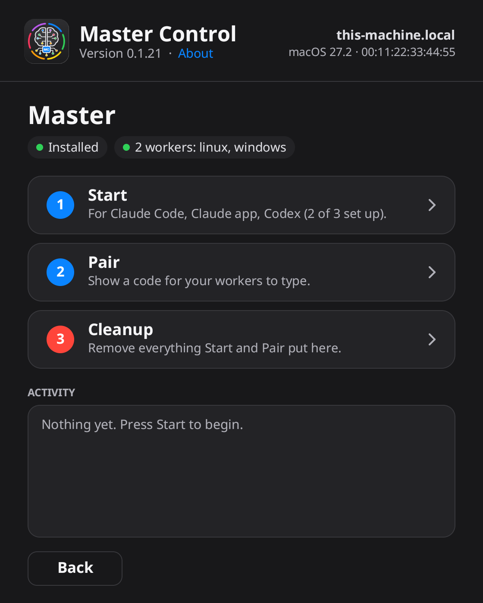

# Master Control

**Master Control** lets an AI coding agent use a computer the way you would at its desk, and watch what a program
does while it runs. I built it to test my own apps on Linux, Windows and macOS without sitting at three keyboards.

One machine is the **master**: the one your agent runs on. The others are **workers** you pair with it. The agent
reaches all of them, the master included, through one set of tools.



It is early (version 0.x) and I use it daily on my own machines. Expect rough edges; [pending.md](pending.md) lists
what is missing and what hasn't been tried.

## What an agent can do with it

- **Run things.** Commands, long jobs you come back to, files in and out, admin rights where the machine allows it.
- **See and use the desktop.** Screenshots, the window list, mouse, keyboard and clipboard.
- **Read inside a window.** Buttons, fields and labels with their names and values, and actions on them (press,
  set a value, toggle, expand, select) that don't move the pointer or need the window in front.
- **Observe a program.** Every program it starts, every file it reads or changes, every connection it makes, and
  its crashes with a call stack. You can set rules ("it may only write here", "it must not touch that") and get a
  verdict at the end of the run.
- **Do several steps in one call**, a later step using an earlier one's answer.

The agent gets these as an MCP server, a command line (`mctl call`) and an HTTP API on each machine.
[AGENT-GUIDE.md](AGENT-GUIDE.md) is the guide agents read; `mctl guide` prints it.

## What works where

| | Linux | Windows | macOS |
|---|---|---|---|
| Commands, jobs, files | yes | yes | yes |
| Screen, pointer, keyboard, clipboard | X11 (no Wayland yet) | yes | yes, after you allow Screen Recording and Accessibility |
| Inside a window | AT-SPI | UI Automation | Accessibility |
| Input without taking the screen | element actions | element actions | element actions, and `background` clicks and keys |
| Observation | system calls, files, network, memory (x86-64) | files, network, registry, memory (needs admin) | programs, files, ports, with less detail; more with admin rights |
| Call stacks | on every event, if asked | on every event, if asked | on crashes |

Android is planned and not started.

## Requirements

- [Rust](https://rustup.rs), a recent stable version. Nothing else: there are no system libraries to install.
- Linux: an X11 session for the screen and input tools.
- Windows: an administrator account for observation.
- macOS: Apple's Command Line Tools (`xcode-select --install`) to build the app.

## Installing

Prebuilt files for macOS, Linux and Windows are on the
[Releases](https://github.com/dunkelherzmann/master-control/releases) page, with how to open each. Or build it
yourself, which takes a few minutes.

```bash
git clone https://github.com/dunkelherzmann/master-control.git
```

```bash
cd master-control
```

**macOS**

```bash
macos/scripts/build.sh
```

This leaves `dist/Master Control.app`; drag it to Applications. The app is signed ad hoc and not notarized by Apple.
One you built yourself opens without complaint. If you copy it to another Mac, macOS will refuse it at first
("Apple could not verify…"). Clear the quarantine flag once:

```bash
xattr -dr com.apple.quarantine "/Applications/Master Control.app"
```

or use **Open Anyway** under System Settings → Privacy & Security.

**Linux and Windows**

```bash
cargo build --release -p master-control
```

The program is `target/release/master-control` (`master-control.exe` on Windows). It is a single file; put it
wherever you like.

## Setting it up

1. On the machine your agent runs on, open Master Control, choose **Master** and press **Start**. That installs the
   master program and adds it as an MCP server to the agents it finds: Claude Code, the Claude app, Codex,
   Antigravity, Gemini CLI, Cursor, Windsurf and VS Code. Quit an agent's app before you press Start, and open it
   again afterwards, or it won't see the tools.
2. On each other machine, open Master Control, choose **Worker** and press **Start**.
3. On the master press **Pair**. It shows a code; type that code into the worker. The two must be on the same
   network.

**Cleanup**, on either side, removes everything Start put there.

If you'd rather not use the window, the same steps exist as commands: `master-control master start`,
`master-control agent start`, `master-control master pair` and so on.

To check it works, ask your agent to call `machines`, or run:

```bash
~/.local/opt/master-control/mctl machines
```

## Security notes

Read these before you pair anything.

- A paired master has full use of a worker: it can run any command there, as an administrator if the machine
  allows that without a password. Pair only machines you own, on a network you trust.
- Traffic between master and worker is encrypted with a key agreed at pairing. A worker takes orders from its one
  master and nobody else.
- An agent connected to the master can do all of this too. That is the point of the tool, and it is also the risk:
  an agent that is tricked or wrong can do damage. I use it on test machines.
- Every call is written to an audit log on the machine it ran on, without file contents or typed text.
- On Windows the worker adds a firewall rule for its port. On macOS the system asks you about incoming connections
  the first time.

## Project layout

```
core/     the event store, the encrypted link, shared types
agent/    what runs on every machine: the tools, desktop control, observation
mctl/     the master: pairing, the MCP server, the command line
app/      the window, drawn by the program itself (no GUI toolkit)
macos/    the Mac app bundle
scripts/  version, checks on all three systems, install
design/   icon and screens
```

[specs.md](specs.md) is the full specification. [CLAUDE.md](CLAUDE.md) holds the notes for agents working on the
code, including the traps I fell into.

## Building and testing

```bash
cargo test --workspace
```

`scripts/check.sh` runs the tests and lints on a Mac, a Linux and a Windows machine over ssh. Copy
`scripts/hosts.env.example` to `scripts/hosts.env` and put your own machines' names in it. The GUI tests open
real windows and send real input, so run them on machines nobody is working on.

## Versioning

The `VERSION` file holds the major and minor number. The patch number is the count of commits since that file
last changed, so every build has its own version without anyone typing one. The About screen and `status` show it.

## Open source

Master Control is free and open source under the [MIT License](LICENSE): use it, change it and share it, for
personal or commercial work. Keep the copyright and license notice with any copy. Third-party components keep
their own licenses; see [NOTICES](NOTICES).

## Support

This is a tool I made for my own testing and share so others can use it. It is provided as is: no support is
promised or given.

What has been reported and what's done is tracked in the open: [bugs.md](bugs.md) and
[enhancements.md](enhancements.md).

## Contributing

Bug reports, ideas and pull requests are welcome: open an
[issue](https://github.com/dunkelherzmann/master-control/issues) or a pull request here. Contributions are
accepted under the same MIT License.

## Contact

Contact me through my GitHub profile: [dunkelherzmann](https://github.com/dunkelherzmann).

Copyright © 2026 Herbert Cisneros, developed with AI coding assistance.
